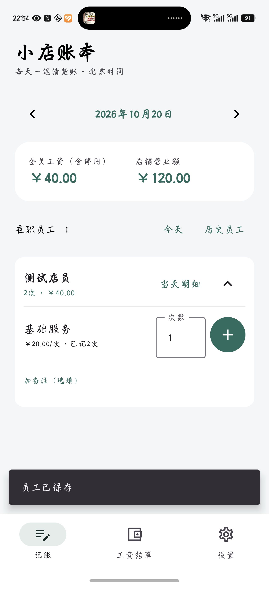
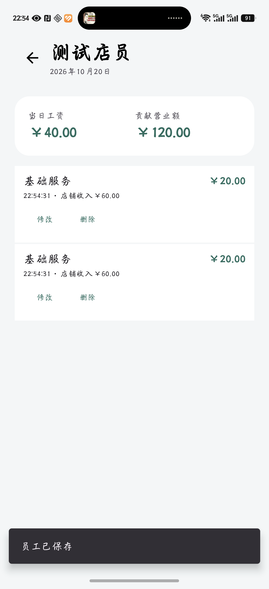
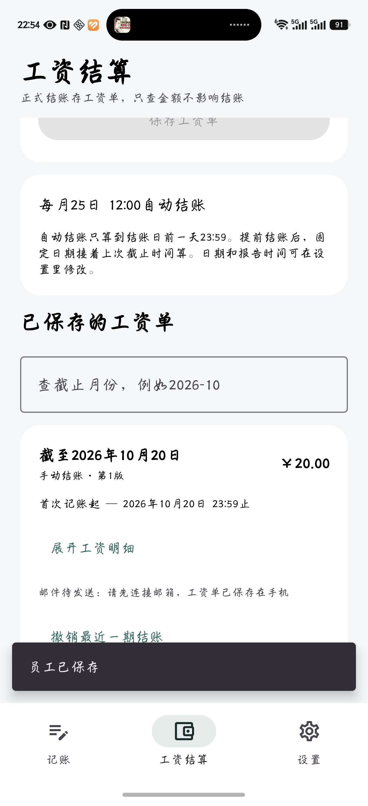
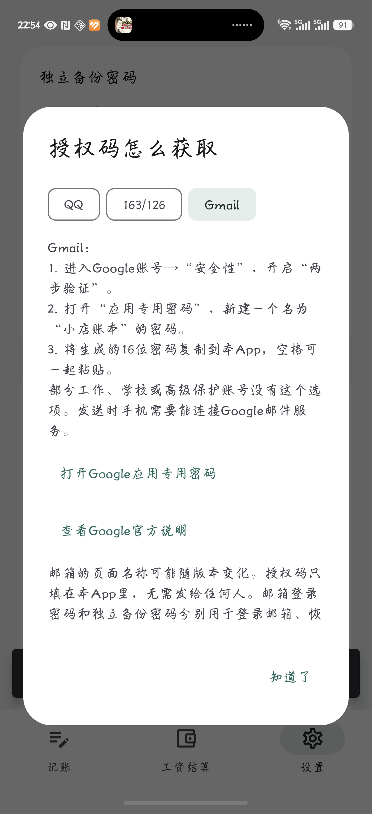

<div align="center">
  
  <h1>小店账本 · Shop Ledger</h1>
  <p>给小店使用的员工计件记账、工资核算与邮件备份 Android App。</p>
  <p>Android 8.0+ · Kotlin · Jetpack Compose · 本地存储</p>
  <p>
    <a href="https://github.com/atrilee0705-netizen/shop-ledger-android/releases/latest">下载安装包</a> ·
    <a href="https://github.com/atrilee0705-netizen/shop-ledger-android/releases/download/v1.2.0/ShopLedger-1.2.0.rar">下载 RAR 完整包</a> ·
    <a href="RECOVERY.md">密码找回说明</a> ·
    <a href="docs/DEVELOPMENT.md">开发文档</a>
  </p>
</div>

## 适合做什么

记录每位员工每天完成了多少次任务，按任务单价计算工资和店铺营业额。平时随手记账，到结账日保存工资单，也可以提前结账、查询任意一段时间，或补记以前漏掉的工作。

账目保存在手机本地，无需注册账号。日常记账可以离线使用；邮件报告和备份需要连接网络并配置自己的邮箱。

## 界面预览

以下截图来自荣耀 Magic6 Pro 上的独立测试副本，使用虚构员工和测试账目。字体可能随手机系统设置变化。

<table>
  <tr>
    <td align="center"><strong>日常记账</strong><br></td>
    <td align="center"><strong>当天明细</strong><br></td>
  </tr>
  <tr>
    <td align="center"><strong>工资结算</strong><br></td>
    <td align="center"><strong>邮箱授权帮助</strong><br></td>
  </tr>
</table>

## 主要功能

| 功能 | 使用方式 |
|---|---|
| 员工与任务 | 添加员工、停用或恢复员工，为每个任务设置员工工资和店铺收入 |
| 按次数记账 | 员工卡片可展开、收起；输入次数后点加号，一次可记录1至999次 |
| 日账与历史 | 按日期查看工资、营业额和工作明细，支持补记过去漏掉的工作 |
| 正式结账 | 提前结账或每月自动结账，接着上次截止点计算并保存工资单 |
| 区间查询 | 自选起止日期，只查看工资、营业额和员工合计，不改变结账进度 |
| 工资单修正 | 补记已结账日期时同步修正原工资单，保留版本和修订记录 |
| 邮件报告 | 工资单及补记后的修正版可自动发到指定邮箱 |
| 完整备份 | 本地导出加密账本，或按每日时间自动发邮件备份，失败后重试 |
| 密码找回 | 手机系统身份验证、题库自选三题、邮箱恢复文件三种找回方式 |
| 外观设置 | 自定义主题色和背景图片 |

## 结账怎么算

所有业务日期使用北京时间。

- **接着上次结账**：从上次工资单的截止点之后接着算，最多结算到昨天23:59:59.999，今天和未来预记账不会进入正式结账。
- **每月自动结账**：例如设为每月15日12:00，工资只算到14日结束。提前结过账，15日仍从上次截止点之后继续算。
- **只查金额**：自由选择几号到几号，包含首尾两天，只查看结果，不生成工资单，也不改变下一次正式结账的起点。
- **补记旧账**：日期属于已保存工资单时，确认后修正原单并生成修订记录，不会再次计入下一期工资。

保存工资单表示完成工资核算，实际发薪由店主自行处理。已结账记录需要修改或删除时，可先撤销最近一期结账；已发出的旧邮件无法收回，修正版会注明以新版为准。

## 安装与上手

1. 打开 [Releases](https://github.com/atrilee0705-netizen/shop-ledger-android/releases/latest)，下载 `ShopLedger-1.2.0-debug.apk`。RAR完整包同时包含安装包和源码。
2. 在手机中安装“小店账本”。更新现有版本请直接覆盖安装，**不要先卸载**，卸载会删除手机内的账本和本机密钥。
3. 到“设置 → 员工管理”和“任务管理”建立员工、任务及单价。
4. 在“记账”页选择工作日期，展开员工，填写次数，点加号保存。
5. 在“工资结算”页结账或只查金额；每月结账日期和报告发送时间可在设置中修改。
6. 按需连接邮箱，并设置完整账本的备份密码和找回方式。

当前版本为 **1.2.0 / versionCode 4**，包名 `cn.shopledger`。发布附件是已在真机测试的调试签名APK；自行构建和后续分发时，需要妥善保存并持续使用同一签名，才能覆盖更新。

## 邮箱、备份与忘记密码

QQ/Foxmail、163、126、yeah.net、Gmail/Googlemail可按邮箱地址自动配置。填写本人邮箱及邮箱提供的授权码，接收邮箱留空即可发给自己；App内有“授权码怎么获取”的步骤说明。

Gmail使用开启两步验证后的应用专用密码，并需要手机网络能够连接Google邮件服务。高级设置支持隐式TLS发信，通常使用465端口。工资文字报告和完整加密账本分别安排发送。

完整备份密码至少6位，纯数字可用。建议首次设置时同时完成：

1. 到“忘记密码 / 密保与找回”，从10题中选择3个不同问题，填写自己的答案。
2. 在本人收件箱保留恢复邮件及 `.ledgerkey` 附件，无需记住文件内容。
3. 设置好密保后重新导出 `.ledgerbak` 账本，或生成一份新的邮件备份。

忘记密码时，原手机可通过系统指纹、强生物识别或锁屏密码验证后重设。换手机可以使用备份和配套恢复文件，或回答该备份生成时设置的三个问题。恢复文件能够解开配套备份，请留在自己的邮箱。

旧版备份不会自动增加密保能力。修改密码只影响之后生成的文件。具体步骤及文件对应关系见 [密码找回说明](RECOVERY.md)。

自动发送受网络、省电及系统后台限制影响，可能延迟；“邮件已提交”表示发信服务接受投递，请另行检查收件箱和垃圾邮件。

## 从源码构建

使用 Android Studio 打开项目根目录，准备 JDK 21、Android SDK Platform 35 和 Build Tools 35.0.0。在本机 `local.properties` 配置 `sdk.dir`，不要提交该文件。

```powershell
# Windows，JAVA_HOME指向JDK 21
.\gradlew.bat :app:assembleDebug
.\gradlew.bat :app:testDebugUnitTest :app:lintDebug
```

macOS / Linux 可使用 `./gradlew`。生成的APK位于 `app/build/outputs/apk/debug/app-debug.apk`。Gradle Wrapper固定为8.11.1并校验发行包SHA-256。

技术栈：Kotlin 2.1.20、Jetpack Compose / Material 3、Room、WorkManager、Jakarta Mail；compileSdk与targetSdk为35，minSdk为26。金额使用整数分保存，数据迁移和账本恢复均经过完整性校验。

详细构建、数据格式、SMTP配置和独立真机测试方式见 [开发文档](docs/DEVELOPMENT.md)。

## 已验证范围

1.2.0完成 **41项本机测试和11项真机测试，全部通过**。真机为荣耀 Magic6 Pro，Android 16；覆盖批量记账、结账截止、补记修单、数据库迁移、三种备份恢复方式、实际系统身份验证，以及测试TLS SMTP发送和重试。

Android Lint为0错误、7条图标提示。尚未覆盖所有品牌机型和长时间跨月运行；邮件测试使用测试端点，真实邮箱收件需自行确认。完整记录见 [验证报告](VALIDATION.md)。

## 项目目录

```text
app/src/main/java/cn/shopledger/
├── data/       数据库、实体与账本事务
├── backup/     加密备份、恢复、邮件及后台任务
└── ui/         Compose页面
app/src/test/               本机测试
app/src/androidTest/        独立真机测试
app/schemas/                Room数据库结构
app/src/main/res/           图标与资源
docs/                       开发文档与演示截图
RECOVERY.md                 密码找回说明
VALIDATION.md               版本验证记录
```

仓库和发布压缩包不包含真实员工账目、邮箱凭据、本机数据库、设备密钥或开发工具缓存。测试中的TLS证书仅用于隔离测试，不会打入正常APK。
