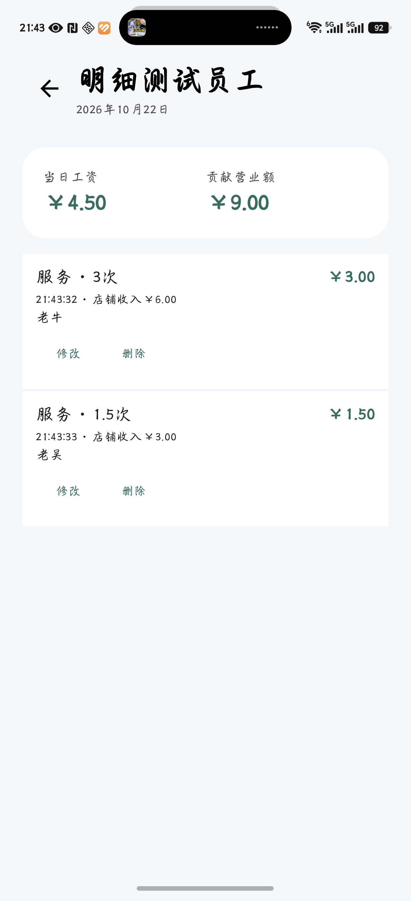

# 1.3.3 验证记录

日期：2026-10-23（北京时间），版本1.3.3 / versionCode 9。本记录随GitHub的v1.3.3发行版提供。

## 改动范围

同次提交的多次任务在当天明细中合并为一条。例如一次提交3次，显示“服务 · 3次”；一次提交1.5次，显示“服务 · 1.5次”。旧的批量记录也适用，不执行数据迁移或重写。

按原行精确创建时间、完成时间、员工、任务、名称和单价快照、备注及结账归属构造显示分组，保持原有排序；不同提交时间、备注或单价不混合。合计直接相加原行的已舍入金额，计价与工资单规则不变。

合并条目的“修改”统一更新本次时间和备注，“删除”删除本次全部次数。确认显示总次数、工资和营业额。事务内重新读取并全部校验原行，缺失或已结账时不执行部分操作。已结账条目继续隐藏修改、删除按钮。

对照1.3.2交付源码逐字节比较：运行时代码仅修改DetailScreen、Ledger，新增WorkEntryGroup。滚轮、震动、结账、备份、恢复及其他界面源文件保持一致；数据库schema 4保持一致。构建配置只更新版本及增加隔离的明细测试包。

## 验证结果

- 58项本机测试通过，0失败、0错误、0跳过。新增分组、分开提交/备注/单价/归属不混合、历史舍入金额、整组修改/删除事务、缺失或已结账时整次拒绝、合并显示和删除确认等回归。既有金额、迁移、工资单、备份、密码恢复与滚轮测试继续通过。
- Android Lint：0错误，8条提示，沿用1.3.2的7条图标提示和1条SharedPreferences KTX建议。
- 荣耀 Magic6 Pro独立真机测试1项通过：3次与1.5次分别一条，底层仍保留5行；修改3次备注同步全部原行；删除取消不改变账目；确认删除3次后1.5次仍保留；结账和停用任务后1.5次仍可查询，工资150分不变，禁止直接改删。
- 真机测试使用新包名cn.shopledger.detailtest，避免重置机主正在试用的cn.shopledger.devicetest。新建副本验证后清理。截图使用虚构员工和测试账目。
- 直接读取交付APK验证cn.shopledger / 1.3.3 / 9及WorkEntryGroup类，签名证书与1.3.2一致。手机正式版已安装APK的SHA-256与交付文件一致。

## 覆盖更新与数据核对

正式版与原调试副本均以install -r覆盖更新，未卸载或清空原应用。分别保存更新前后私有快照，检查SQLite完整性、外键及全部原始行。

正式版29条工作记录的ID、次数、历史单价、时间、备注及其他核算字段全部保持；原工资单和明细保留。快照间在21:38:36新增了一份手动提前结账单，早于21:45:02正式更新，自动结账设置为关闭。这份新单及其17条工作归属予以保留，逐项核对归属区间和分员工金额符合原记录，没有回滚机主期间的结账。除此之外，设置、本机状态、恢复配置、背景和滚轮偏好均保持。

原调试副本9名员工、2个任务、16条记录、1份工资单及各设置/状态表在更新前后全部原始行保持一致。该副本仅覆盖更新，未运行清空数据的测试。

verification目录包含本机和真机测试、Lint、元数据、安装文件核对和无账目内容的升级摘要。原始账目、私有快照、密钥及凭据均不进入交付源码包。

