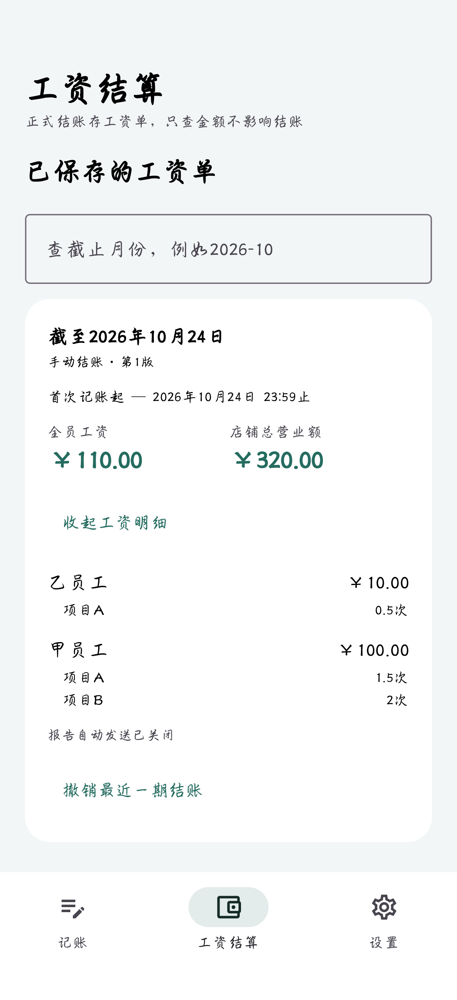

# 1.3.4 验证记录

日期：2026-10-25（北京时间），版本1.3.4 / versionCode 10。本记录随GitHub的v1.3.4发行版提供。

## 工资单增加的内容

每位员工的工资下列出各项目完成次数，例如项目A 1.5次、项目B 2次。待结账预览、区间查询及已保存工资单采用相同的分员工项目汇总；保存单卡片同时显示全员工资与本期店铺总营业额。

保存单按工作记录的settlementId读取，项目使用历史任务名称与整数十分之一次，营业额按每条记录的历史收入金额相加。停用、改名或改价不会改写原单金额。补记后原单的项目次数、工资和营业额同步刷新，不进入下一期。

工资邮件及补记修正版增加同样的项目次数与店铺总营业额，在原来的数据库事务内读取对应版本和工作记录。已发邮件不自动重发；发送状态、修订版本、失败重试及工资计算规则保持不变。数据库schema仍为4，备份格式无变化。

## 验证结果

- 65项本机测试通过，0失败、0错误、0跳过。新增保存单SQL营业额和明细Flow、项目次数、原价舍入、停用/改名历史、排除其他期及未结账记录、空工资单、补记刷新和界面测试；既有回归全部通过。
- Android Lint为0错误、8条既有提示。
- 荣耀 Magic6 Pro独立副本真机测试2项通过。界面验证甲员工项目A 1.5次、项目B 2次，乙员工项目A 0.5次，全员工资110元、店铺总营业额320元；补记乙员工项目B 0.5次后，工资127.50元、营业额370元，项目次数同步更新。停用员工及改名改价后的项目保留原名称与金额。
- 使用手机内的隔离TLS SMTP端点实际发送原工资报告和修正版，收取并解码邮件正文，确认原单项目A 1.5次、项目B 0.5次、工资47.50元、营业额140元；补记后项目B为1次，工资65元、营业额190元。没有联系任何真实邮箱。
- 校验交付APK的包名cn.shopledger、版本1.3.4 / 10及新增报告/项目汇总类；签名证书与1.3.3一致。运行时代码仅修改LedgerViewModel、LedgerDao、BackupEngine、SettlementScreen，新增TaskQuantity和SettlementReport；记账、滚轮、明细分组、密码恢复及其他文件保持原实现。

## 覆盖更新

正式版更新前停止应用并保存私有快照，使用install -r从1.3.3 / 9覆盖为1.3.4 / 10。首次打开新版前取得更新后快照，SQLite完整性和外键检查通过；逐项比较全部原始行和字段一致：2名员工、2个任务、28条工作记录、2份工资单、3条员工工资明细，以及公共设置、本机状态、恢复配置和恢复尝试表。背景和已有滚轮偏好也保持一致。

核对手机已安装APK的SHA-256与交付文件完全相同，随后正常启动新版。测试只在新建cn.shopledger.detailtest副本操作；验证后清理该副本，未清空正式账本。

源码包verification目录包含测试、Lint及不含账目内容的安装包/升级摘要；原始私有快照、数据库、凭据和设备秘密不进入交付源码。

以下为独立副本的应用窗口截图，仅含虚构测试账目。

